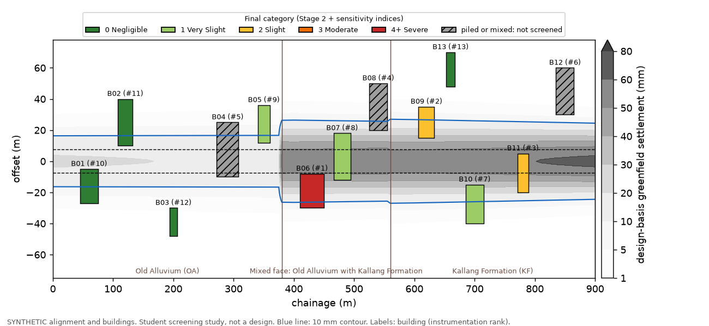
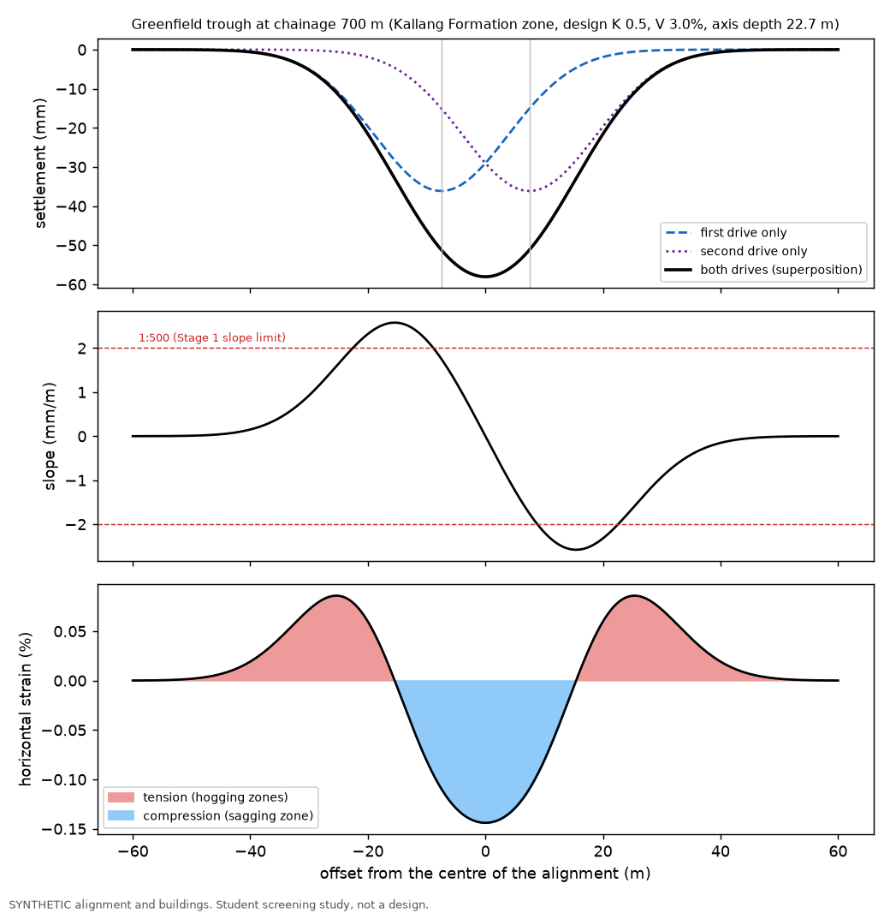
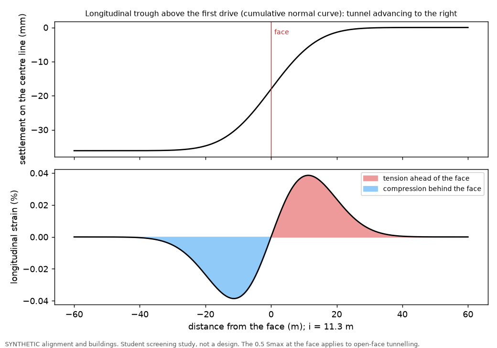
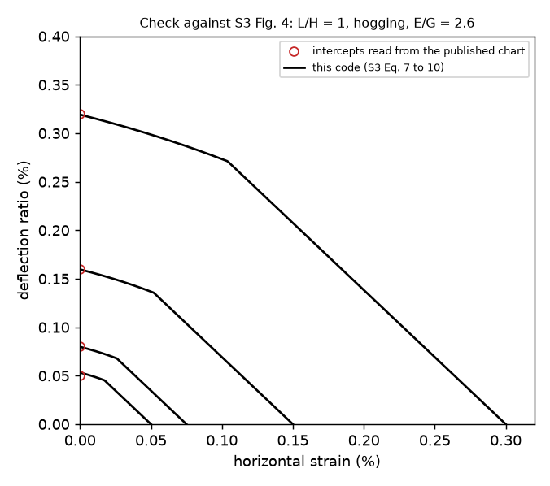
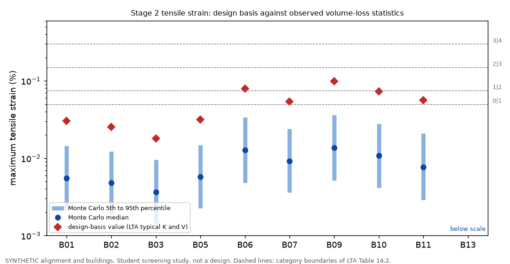
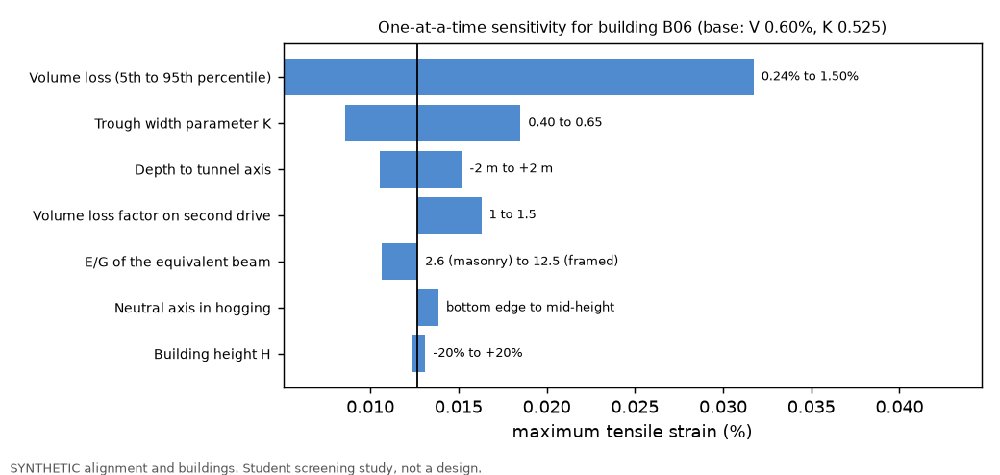
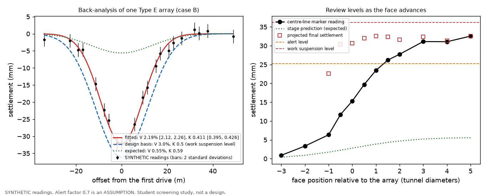

# sg-tunnel-settlement-assessment

> **Read this first.** Personal portfolio project, built with AI assistance. It is independent: not affiliated with,
> commissioned by or endorsed by the Land Transport Authority (LTA) or any other body, and it uses no non-public
> information. **It is a student-level screening study with textbook empirical methods. It is not a design, it has
> not been checked by a qualified geotechnical engineer, and it must not be used on any project.** The alignment,
> the buildings and the monitoring readings are SYNTHETIC: they are not a real line, station, building or site.
> No finite-element or commercial ground-movement software was used. The author has no professional geotechnical
> or tunnelling experience. Every input is labelled REAL, DERIVED, ASSUMPTION, ILLUSTRATIVE or SYNTHETIC in the
> [provenance table](#provenance). Author: Wenjie Luo (GitHub LUOaini1213).

<!-- Generated by scripts/build_docs.py from results/*.json, data/*.csv and inputs/. Edit docs/templates/README.md instead. -->

This repository works through the standard first-pass check that is made before a bored tunnel is driven under a
city: how much will the ground settle, which buildings need a closer look, what should be measured during the
drive, and what do the measurements say once they come in. It uses the empirical method that LTA's published
Civil Design Criteria name for this purpose (the Gaussian settlement trough and the limiting tensile strain
method), applies it to an invented twin-tunnel drive, and checks every equation against its published source.

The aim is to show that the method is understood and implemented correctly, with its limits stated. It does not
imitate a consultant's design report.

## Headline results

- **Sources first.** 128 statements were recorded with a locator and a supporting quotation from
  13 public documents opened on 2026-11-24; 115 are marked VERIFIED (the quotation was
  matched against the text of the opened document) and 13 UNVERIFIED (primary papers that could not
  be opened and are relied on only as reported by an opened source). See [docs/reference_sheet.md](docs/reference_sheet.md).
  The current LTA edition is Revision A3 (December 2025); it sends a building to detailed evaluation from
  category "slight", one category earlier than the 2019 revision.
- **Verification.** 13 published values or closed-form identities are reproduced to stated tolerances
  ([table below](#verification)), including the LTA formula coefficient 0.0031, Peck's properties of the error
  curve, and the four boundaries of the published damage chart for a building with length equal to height.
- **Design-basis screening.** With LTA's typical trough width and volume loss, 2 of the
  13 SYNTHETIC buildings are negligible at Stage 1, 5 are low risk at Stage 2, and
  6 need work this study cannot do: 3 on shallow foundations go to Stage 3 detailed
  evaluation, 1 on mixed foundations goes to Stage 3, and 2 on piles need a pile assessment.
  The largest predicted tensile strain is 0.098% (building B09).
- **Design basis against experience.** Published records from recent Singapore drives give much lower volume
  losses than the design values (mean 0.55% against 3.0% in Kallang Formation). Sampling
  those records, the chance that any one shallow-founded building reaches Stage 2 category "very slight" or
  higher is at most 1.6% (building B09); the chance that volume loss exceeds the design
  value is 0.04% to 0.27% depending on the ground zone. These probabilities
  depend on an assumed distribution shape and exclude stoppages; they are not risk figures for any project.
- **What drives the answer.** In the sensitivity study for building B06, volume loss dominates, then the trough width parameter K, then tunnel depth. Its
  maximum tensile strain moves from 0.005% to 0.032% across the 5th to 95th percentile
  of volume loss. The sensitivity indices for building form and condition can decide the outcome on their own:
  building B06 is "slight" or worse in every sample because of its structural-form index, whatever the ground does.
- **A choice the method leaves open.** Eq. 9 and 10 of Mair, Taylor and Burland (1996) let a compressive average
  horizontal strain in a sagging span offset the bending strain. Setting it to zero instead, a cautious reading,
  raises building B11 from Stage 2 category 1 to 2 and changes no next step (B11 already goes to Stage 3 detailed evaluation for another reason). The largest strain changes for 2 of 10 buildings (table below).
- **Existing tunnel above the drive (SYNTHETIC).** Free-field settlement at the invert level of an invented
  existing tunnel is 22.1 mm on the design basis, above the 15 mm allowable total movement in
  LTA's Code of Practice for Railway Protection, and the steepest gradient along it, 1:601, is
  steeper than the 1:1000 differential limit. At the characteristic volume loss of the Singapore records the
  figures are 11.1 mm and 1:1202; at the mean, 5.1 mm. This is a ground-movement proxy;
  the structure is not modelled.
- **Monitoring.** A notional plan after LTA's Chapter 13 gives 74 Type D points, 16 Type E arrays
  (312 points), 1 Type F array and 36 building points, each with an alert and a
  work suspension level. 6 buildings in use have part of a tunnel under them, so each is monitored in real
  time and gets Type E arrays about 25 m and 50 m before it (11 such arrays; B01 is too close to the start of the drive for the second). For B02 and B06 only the edge
  of a tunnel is under the footprint; the CDC wording ("directly or partially underneath") still covers them. The
  alert factor of 0.7 is an ASSUMPTION.
- **Back-analysis.** From 22 SYNTHETIC marker readings with 1 mm noise, the fit returns volume
  loss 2.19% (95% interval 2.12 to 2.26) and K 0.411 (0.395 to 0.426) for a
  true 2.2% and 0.42. No marker reaches the work suspension level, yet the fitted trough is
  narrower and therefore steeper (1:477) than the design trough (1:517): a check
  on settlement alone would have missed that. The reading on the centre line reaches the alert level
  when the face is 1.5 tunnel diameters past the array; the final settlement projected from the partial readings reaches it
  when the face is still 0.5 tunnel diameters short of the array, 2 tunnel diameters of advance earlier.
- **An estimator compared.** On repeated SYNTHETIC arrays, a straight-line fit to the logarithm of the readings
  (the approach described in the Singapore literature) over-estimates volume loss by 13% if readings
  down to 5% of the maximum are kept and by 2% if only readings above 20% are kept; least squares on
  the curve itself is unbiased here (+0.0%). This is a property of the estimator under the noise assumed
  here; it says nothing about the published results, which used real arrays and their own data screening.
- **A bug the cross-check caught.** The first draft of the Excel workbook returned a settlement of about
  1,800 km: in Excel `-x^2` means `(-x)^2`. The test that recalculates the workbook and compares it with Python
  found it.
- **Tests.** 199 tests. Hand-written mutation testing (one plausible error planted at a time, such as a
  wrong sign, i in place of z0 or the neutral axis in the wrong place) killed 108 of
  117 on the first run. The final review added 42 mutants, of which
  40 were killed on their first run; after tests were written for the survivors,
  (not yet run) of all (not yet run) are killed ([results/mutation.json](results/mutation.json)).



## Reader outputs

| Output | File |
|---|---|
| Four-page technical note (method, verification, results, limits) | [docs/technical_note.pdf](docs/technical_note.pdf) |
| Sourced reference sheet (128 statements with quotations) | [docs/reference_sheet.md](docs/reference_sheet.md), [data/facts.csv](data/facts.csv) |
| Sources, access dates and terms | [DATA_SOURCES.md](DATA_SOURCES.md) |
| Formula-by-formula audit against the sources | [docs/formula_audit.md](docs/formula_audit.md) |
| Excel workbook with live formulas (trough and one Stage 2 check) | [workbook/trough_and_stage2.xlsx](workbook/trough_and_stage2.xlsx) |
| Screening table, design basis | [results/screening_design_basis.csv](results/screening_design_basis.csv) |
| Instrument list with review levels | [results/instruments.csv](results/instruments.csv) |
| Figures | [docs/figures/](docs/figures/) |

## Method in brief

Abbreviations: LTA, Land Transport Authority; CDC, LTA's Civil Design Criteria; TBM, tunnel boring machine; EPB,
earth pressure balance (a closed-face TBM type); OA, Old Alluvium; KF, Kallang Formation.

1. **Greenfield settlement.** Transverse trough `S = Smax exp(-y^2 / 2i^2)` with `i = K z0` and
   `Smax = V pi D^2 / (4 sqrt(2 pi) i)` (Peck 1969; O'Reilly and New 1982; CDC Cl. 14.2.1.2). Horizontal
   movement is directed at the tunnel axis, `u = (y / z0) S` towards the centre line. The longitudinal trough is
   a cumulative normal curve. Twin tunnels are superposed.
2. **Stage 1.** A building is negligible risk if the settlement under it is below 10 mm and the slope is flatter
   than 1:500 (CDC Section 14.3.6).
3. **Stage 2.** Each facade is cut at the points of inflexion and at 2.5 i. Each span is a deep beam: sagging
   with the neutral axis at mid-height, hogging with it at the bottom edge. The deflection ratio gives bending
   and diagonal strains, the average horizontal strain is added, and the larger total gives the damage category
   from CDC Table 14.2 (Mair, Taylor and Burland 1996, Eq. 7 to 10). Sensitivity indices for building form,
   heritage features and condition are added (CDC Section 14.3.10).
4. **Uncertainty.** Volume loss is sampled from a lognormal matched to the published mean and 95% value for each
   ground type; K is sampled across a stated range.
5. **Monitoring.** Array types and spacings follow CDC Chapter 13. A building counts as having a tunnel under it
   when any part of the excavated width is under its footprint (CDC Section 13.4.9). The work suspension level is
   the design-basis prediction; the alert level is a stated fraction of it.
6. **Back-analysis.** Volume loss and K are estimated by least squares from marker readings, with confidence
   intervals, and compared with the prediction.



As the face advances the trough develops along the tunnel; a facade parallel to the tunnel is in hogging and
tension ahead of the face and in sagging and compression behind it.



## Verification

Published values reproduced by the code. Source IDs are listed in [DATA_SOURCES.md](DATA_SOURCES.md). The same
checks are tests in `tests/test_published.py`.

| ID | Quantity | Source | Published | This code | Tolerance |
|---|---|---|---|---|---|
| V1 | LTA coefficient: Smax i / (V D^2) with V in % | S1 Cl. 14.2.1.2 | 0.0031 | 0.00313329 | 1.1% (the published coefficient is rounded to two figures) |
| V2 | Mair et al. coefficient: Smax K z0 / (Vl D^2) with Vl as a fraction | S3 Eq. 5 | 0.31 | 0.313329 | 1.1% (rounded to two figures) |
| V3 | Trough volume / (i Smax) | S9 Fig. 8 | 2.5 | 2.50663 | 0.3% (published as 2.5; exact value sqrt(2 pi)) |
| V4 | Numerical trough volume / volume loss | S3 Eq. 3-4 | 1 | 1 | 1e-9 |
| V5 | Settlement at the point of inflexion / Smax | S9 section 1.4.6 | 0.61 | 0.606531 | 0.005 |
| V6 | Settlement at the point of maximum hogging curvature (sqrt(3) i) / Smax | S9 Fig. 8 | 0.22 | 0.22313 | 0.005 |
| V7 | Maximum horizontal movement / (K Smax) | S4 section 5.5 | 0.61 | 0.606531 | 0.005 |
| V8 | Settlement above the face / Smax | S3 section 2.3 | 0.5 | 0.5 | 1e-12 |
| V9 | Longitudinal displacement at the face on the centre line x 8 z0 / (VL D^2) | S6 Eq. 2.17 | 1 | 1 | 1e-12 |
| V10 | Surface K from the subsurface relation at z = 0 | S4 Eq. 8 | 0.5 | 0.5 | 1e-12 |
| V11 | Damage chart, L/H = 1 hogging: Delta/L (%) on the category boundaries at zero horizontal strain | S3 Fig. 4 (values read from the chart) | 0.05, 0.08, 0.16, 0.32 | 0.0532051, 0.0798077, 0.159615, 0.319231 | 0.01 (chart-reading accuracy) |
| V12 | Diagonal strain for eps_h = eps_d = 0.1%: 0.35 x 0.1 + sqrt(0.065^2 + 0.1^2) | S3 Eq. 10 | 0.154269 | 0.154269 | 1e-12 |
| V13 | Characteristic volume loss from mean 0.30% and standard deviation 0.24% (%) | S5 section 4.5.1 | 0.7 | 0.694764 | 0.05 (published to one decimal) |

Check V11 in picture form: the published chart redrawn from the implemented equations.



Beyond these, the beam factors of Eq. 7 and 8 are re-derived in a test from a centrally loaded Timoshenko beam,
the diagonal-strain formula is compared with the largest eigenvalue of the strain tensor, and every derivative
(slope, curvature, horizontal strain) is compared with a numerical derivative.

Two things the checks turned up:

- One secondary source prints the diagonal-strain formula with `(1 - nu)/2` inside the square root. The primary
  paper, a second opened source and Mohr's circle all give `(1 + nu)/2`; the code follows those and a test shows
  the two forms differ.
- The statement that hogging is more damaging than sagging for the same deflection ratio holds from the beam
  equations alone only for spans of about three times the height or more. For a span equal to the height the
  sagging beam has the larger bending strain. A test records both cases.

## Results

### Design-basis screening

Design basis means the typical K and V of CDC Table 14.1 for the ground zone: Old Alluvium (OA): K 0.45, V 1.0%; Mixed face: Old Alluvium with Kallang Formation: K 0.45, V 3.0%; Kallang Formation (KF): K 0.5, V 3.0%.

| Rank | Building | Ground | Foundation | Max settlement (mm) | Max slope | Stage 1 | Max tensile strain (%) | Governing case | Stage 2 category | Index sum | Final category | Next step |
|---|---|---|---|---|---|---|---|---|---|---|---|---|
| 1 | B06 Abutting masonry shophouses | Z2 | shallow | 49.8 | 1:398 | go on | 0.079 | transverse, both drives (hogging/bending) | 2 Slight | 2 | 4 Severe | Stage 3 detailed evaluation (S1 Section 14.3.6); outside this study |
| 2 | B09 Two-storey masonry terrace | Z3 | shallow | 34.0 | 1:413 | go on | 0.098 | transverse, both drives (hogging/bending) | 2 Slight | 0 | 2 Slight | Stage 3 detailed evaluation (S1 Section 14.3.6); outside this study |
| 3 | B11 Old masonry workshop in poor condition | Z3 | shallow | 59.6 | 1:363 | go on | 0.056 | longitudinal, drive 1 passing (hogging/bending) | 1 Very Slight | 1 | 2 Slight | Stage 3 detailed evaluation (S1 Section 14.3.9, poor existing condition); outside this study |
| 4 | B08 Framed block with extension on mixed foundations | Z2 | mixed | 21.2 | 1:421 | go on | - | - | - | 0 | - | Stage 3 detailed evaluation (S1 Section 14.3.8, mixed foundations); outside this study |
| 5 | B04 Nine-storey framed block on bored piles | Z1 | piled | 19.5 | 1:1145 | go on | - | - | - | 0 | - | Pile assessment (S1 Section 14.3.7); outside this study |
| 6 | B12 Twelve-storey framed tower on piles | Z3 | piled | 3.8 | 1:1251 | negligible | - | - | - | 0 | - | Pile assessment (S1 Section 14.3.7); outside this study |
| 7 | B10 Five-storey framed block on footings | Z3 | shallow | 34.1 | 1:388 | go on | 0.073 | transverse, both drives (hogging/diagonal) | 1 Very Slight | 0 | 1 Very Slight | None: low risk at Stage 2 |
| 8 | B07 Three-storey framed building on a raft | Z2 | shallow | 58.0 | 1:388 | go on | 0.054 | transverse, first drive only (hogging/diagonal) | 1 Very Slight | 0 | 1 Very Slight | None: low risk at Stage 2 |
| 9 | B05 Masonry hall with brittle finishes | Z1 | shallow | 13.8 | 1:1183 | go on | 0.032 | transverse, both drives (hogging/bending) | 0 Negligible | 1 | 1 Very Slight | None: low risk at Stage 2 |
| 10 | B01 Two-storey masonry shophouse row | Z1 | shallow | 19.3 | 1:1006 | go on | 0.030 | transverse, both drives (hogging/bending) | 0 Negligible | 0 | 0 Negligible | None: low risk at Stage 2 |
| 11 | B02 Four-storey framed block on footings | Z1 | shallow | 15.9 | 1:1042 | go on | 0.025 | transverse, both drives (hogging/diagonal) | 0 Negligible | 0 | 0 Negligible | None: low risk at Stage 2 |
| 12 | B03 Two-storey masonry house | Z1 | shallow | 1.5 | 1:3471 | negligible | 0.018 | transverse, both drives (hogging/bending) | 0 Negligible | 0 | 0 Negligible | None: negligible at Stage 1 |
| 13 | B13 Single-storey masonry pavilion | Z3 | shallow | 0.1 | 1:41482 | negligible | 0.000 | longitudinal, drive 2 passing (hogging/bending) | 0 Negligible | 0 | 0 Negligible | None: negligible at Stage 1 |

"Stage 3" and "pile assessment" are the next steps the CDC requires; neither is done here. For piled buildings
and buildings on mixed foundations the table gives only the free-field settlement and slope at the footprint.

### Compressive strain in sagging spans

Mair, Taylor and Burland (1996) combine the average horizontal strain with the bending and diagonal strains
(Eq. 9 and 10) and note that the largest combined tensile strain "will usually occur in the hogging zone, where
the horizontal strains are tensile". Taken as written, the equations let compression in a sagging span reduce the
total, and that is what the screening above does. The table repeats the design-basis Stage 2 check with the
compressive average strain set to zero in sagging spans. Only buildings whose result changes are listed.

| Building | Max tensile strain as written (%) | With compression in sagging set to zero (%) | Governing mode then | Stage 2 category | Next step |
|---|---|---|---|---|---|
| B07 | 0.054 | 0.058 | sagging/diagonal | 1 (unchanged) | unchanged |
| B11 | 0.056 | 0.095 | sagging/bending | 1 to 2 | unchanged |

### Design basis against observed volume loss

| Building | V design / characteristic / mean (%) | Max settlement (mm) | Max tensile strain (%) | Stage 2 category |
|---|---|---|---|---|
| B01 | 1 / 0.5 / 0.23 | 19.3 / 9.7 / 4.4 | 0.030 / 0.015 / 0.007 | 0 / 0 / 0 |
| B02 | 1 / 0.5 / 0.23 | 15.9 / 8.0 / 3.7 | 0.025 / 0.013 / 0.006 | 0 / 0 / 0 |
| B03 | 1 / 0.5 / 0.23 | 1.5 / 0.7 / 0.3 | 0.018 / 0.009 / 0.004 | 0 / 0 / 0 |
| B05 | 1 / 0.5 / 0.23 | 13.8 / 6.9 / 3.2 | 0.032 / 0.016 / 0.007 | 0 / 0 / 0 |
| B06 | 3 / 1.5 / 0.7 | 49.8 / 24.9 / 11.6 | 0.079 / 0.040 / 0.018 | 2 / 0 / 0 |
| B07 | 3 / 1.5 / 0.7 | 58.0 / 29.0 / 13.5 | 0.054 / 0.027 / 0.013 | 1 / 0 / 0 |
| B09 | 3 / 1.2 / 0.55 | 34.0 / 13.6 / 6.2 | 0.098 / 0.039 / 0.018 | 2 / 0 / 0 |
| B10 | 3 / 1.2 / 0.55 | 34.1 / 13.6 / 6.2 | 0.073 / 0.029 / 0.013 | 1 / 0 / 0 |
| B11 | 3 / 1.2 / 0.55 | 59.6 / 23.8 / 10.9 | 0.056 / 0.022 / 0.010 | 1 / 0 / 0 |
| B13 | 3 / 1.2 / 0.55 | 0.1 / 0.0 / 0.0 | 0.000 / 0.000 / 0.000 | 0 / 0 / 0 |

### Probabilities under observed volume-loss statistics

10,000 samples; both drives share one volume-loss draw. Interval: 95% Wilson interval.

| Building | Zone | Settlement 5th / 50th / 95th percentile (mm) | Not negligible at Stage 1 (%) | Stage 2 category 1 or higher (%) | Stage 2 category 2 or higher (%) | Final category 2 or higher (%) |
|---|---|---|---|---|---|---|
| B01 | Z1 | 1.5 / 3.7 / 9.4 | 3.91 (3.55 to 4.31) | 0.01 (0.00 to 0.06) | 0.00 (0.00 to 0.04) | 0.00 (0.00 to 0.04) |
| B02 | Z1 | 1.2 / 3.1 / 7.8 | 1.78 (1.54 to 2.06) | 0.01 (0.00 to 0.06) | 0.00 (0.00 to 0.04) | 0.00 (0.00 to 0.04) |
| B03 | Z1 | 0.1 / 0.3 / 1.0 | 0.00 (0.00 to 0.04) | 0.00 (0.00 to 0.04) | 0.00 (0.00 to 0.04) | 0.00 (0.00 to 0.04) |
| B04 | Z1 | 1.5 / 3.7 / 9.4 | 4.02 (3.65 to 4.42) | not screened | not screened | not screened |
| B05 | Z1 | 1.1 / 2.7 / 6.8 | 0.93 (0.76 to 1.14) | 0.01 (0.00 to 0.06) | 0.00 (0.00 to 0.04) | 0.01 (0.00 to 0.06) |
| B06 | Z2 | 3.7 / 9.2 / 23.3 | 43.72 (42.75 to 44.69) | 0.97 (0.80 to 1.18) | 0.11 (0.06 to 0.20) | 100.00 (99.96 to 100.00) |
| B07 | Z2 | 4.2 / 10.5 / 26.7 | 53.50 (52.52 to 54.48) | 0.13 (0.08 to 0.22) | 0.01 (0.00 to 0.06) | 0.01 (0.00 to 0.06) |
| B08 | Z2 | 1.8 / 4.5 / 11.4 | 7.99 (7.47 to 8.54) | not screened | not screened | not screened |
| B09 | Z3 | 2.0 / 5.2 / 13.4 | 13.09 (12.44 to 13.77) | 1.58 (1.35 to 1.84) | 0.18 (0.11 to 0.28) | 0.18 (0.11 to 0.28) |
| B10 | Z3 | 2.0 / 5.2 / 13.5 | 13.31 (12.66 to 13.99) | 0.44 (0.33 to 0.59) | 0.03 (0.01 to 0.09) | 0.03 (0.01 to 0.09) |
| B11 | Z3 | 3.4 / 8.8 / 22.7 | 41.05 (40.09 to 42.02) | 0.07 (0.03 to 0.14) | 0.00 (0.00 to 0.04) | 0.07 (0.03 to 0.14) |
| B12 | Z3 | 0.3 / 0.8 / 2.3 | 0.00 (0.00 to 0.04) | not screened | not screened | not screened |
| B13 | Z3 | 0.0 / 0.0 / 0.2 | 0.00 (0.00 to 0.04) | 0.00 (0.00 to 0.04) | 0.00 (0.00 to 0.04) | 0.00 (0.00 to 0.04) |

With independent draws for the two drives the largest probability of Stage 2 category 1 or higher is
0.6% (building B09).



### Sensitivity

Building B06: base maximum tensile strain 0.0127% at V 0.60%, K 0.525.

| Input | Range | Strain at low end (%) | Strain at high end (%) | Swing (%) |
|---|---|---|---|---|
| Volume loss (5th to 95th percentile) | 0.24% to 1.50% | 0.0051 | 0.0317 | 0.0267 |
| Trough width parameter K | 0.40 to 0.65 | 0.0185 | 0.0086 | 0.0099 |
| Depth to tunnel axis | -2 m to +2 m | 0.0152 | 0.0105 | 0.0046 |
| Volume loss factor on second drive | 1 to 1.5 | 0.0127 | 0.0163 | 0.0036 |
| E/G of the equivalent beam | 2.6 (masonry) to 12.5 (framed) | 0.0127 | 0.0106 | 0.0020 |
| Neutral axis in hogging | bottom edge to mid-height | 0.0127 | 0.0139 | 0.0012 |
| Building height H | -20% to +20% | 0.0131 | 0.0123 | 0.0008 |



### Monitoring plan and review levels

| Item | Number | Basis |
|---|---|---|
| Type D ground settlement points | 74 | CDC Cl. 13.4.2.1 a): every 25 m of each tunnel |
| Type E arrays (lines of settlement points across the tunnels) | 16 arrays, 312 points | CDC Cl. 13.4.2.1 b): every 200 m; Section 13.4.9: about 25 m and 50 m before each building in use with any part of a tunnel under it |
| Type F arrays (with subsurface instruments) | 1 | CDC Cl. 13.4.2.1 c): every 1000 m |
| Building settlement points | 36 | CDC Cl. 13.4.7.1; points at facade ends, predicted inflexion points and the deepest point (ASSUMPTION) |
| Buildings monitored in real time | 6 (B01, B02, B04, B06, B07, B11) | CDC Section 13.4.9: in use, with any part of a tunnel directly or partially underneath |
| Buildings with tensile strain monitoring | 0 | CDC Cl. 13.4.7.2: predicted tensile strain above 0.1% |

The work suspension level of each point is the settlement predicted with the design-basis K and V, following
CDC Cl. 13.7.4 ("the highest ... reading anticipated based on the design"), with a floor of 5 mm.
The alert level is 0.7 times the work suspension level. CDC Chapter 13 defines the two levels but
gives no ratio, so the factor, the floor and the heave levels are ASSUMPTIONS.

### Back-analysis demonstration

Two arrays of SYNTHETIC readings taken after the first drive only. "Expected" is the prediction with the observed
mean volume loss and best-fit K of the ground zone; "design" is the prediction with the CDC typical values, which
also sets the work suspension level. The 95% intervals come from the least-squares covariance and are compared
with a parametric bootstrap.

| Case (SYNTHETIC) | True V / K | Estimated V (95% interval) | Estimated K (95% interval) | Bootstrap 95% interval for V (%) | Design V / K | Departure from expected | Review state of the markers | Max slope, fitted against design |
|---|---|---|---|---|---|---|---|---|
| A: Old Alluvium array, drive performing as experience suggests | 0.3% / 0.48 | 0.31% (0.22 to 0.39) | 0.517 (0.353 to 0.681) | 0.23 to 0.40 | 1% / 0.45 | not flagged (largest z 1.9) | 22 normal, 0 alert, 0 work suspension | 1:5562 against 1:1294 |
| B: Kallang Formation array, larger volume loss and a narrower trough than assumed | 2.2% / 0.42 | 2.19% (2.12 to 2.26) | 0.411 (0.395 to 0.426) | 2.12 to 2.26 | 3% / 0.5 | flagged (largest z 26.6) | 13 normal, 9 alert, 0 work suspension | 1:477 against 1:517 |



Estimators compared on 300 repeated SYNTHETIC arrays (true V 2.2%, K 0.42):

| Estimator | Mean V (%) | Standard deviation of V (%) | Mean K | Standard deviation of K |
|---|---|---|---|---|
| least squares on the Gaussian curve | 2.200 | 0.036 | 0.420 | 0.008 |
| straight-line method (S5), readings above 0.05 Smax | 2.486 | 0.436 | 0.470 | 0.084 |
| straight-line method (S5), readings above 0.2 Smax | 2.243 | 0.057 | 0.424 | 0.012 |

## What the greenfield assumption does

The method assumes the building has no stiffness and follows the free-field ground. That has a direction:

- **It over-predicts for most buildings.** The CDC calls Stage 2 "a conservative assumption" because the
  stiffness of a building reduces both the deflection ratio and the horizontal strains; Mair, Taylor and Burland
  (1996) call it "usually very conservative". Buildings on strip footings or rafts are likely to pick up very
  little horizontal strain. So a Stage 2 category is an upper estimate of possible damage, which is what a
  screening step should give, and it is not a prediction of damage.
- **It can under-predict in specific cases, which is why they are routed elsewhere.** Piles with toes directly
  above the tunnel were found to settle more than the ground surface (CDC Section 14.3.7). In sands the
  towards-axis rule can under-estimate horizontal movement near the edge of the trough (Mair and Taylor 1997).
  Superposition of twin tunnels may be unconservative when the clear separation is under one diameter (it is
  8.4 m here against a diameter of 6.6 m). Consolidation settlement, which the CDC requires to
  be added, is not included. Volume loss at stoppages is higher.
- **Consequence for the probabilities above.** They are probabilities that the screening criterion is exceeded
  under the stated distributions, not probabilities of damage. The bias from ignoring stiffness makes them too
  high; the bias from leaving out consolidation, stoppages and tunnel interaction makes them too low. The study
  does not quantify either.

## Limits

- Student-level screening with textbook empirical methods. Not a design, not checked by a qualified geotechnical
  engineer, not for use on any project.
- No ground investigation data, no soil model, no numerical analysis, no consolidation, no groundwater.
- The alignment, buildings, existing tunnel and readings are SYNTHETIC. Results must not be attached to any real
  line, station or building.
- Volume-loss statistics are taken from one open-access paper for EPB drives; the lognormal shape and the K ranges
  are the author's assumptions. The paper itself notes that the data do not always follow a normal distribution.
- The longitudinal trough uses the 0.5 Smax-at-the-face curve, which the literature says applies to open-face
  tunnelling; closed-face machines develop less settlement at the face.
- The subsurface relation was published for tunnels in clay; it is applied here to a stylised Old Alluvium zone
  with a scaling that is an assumption.
- Stage 3 evaluation, pile assessment, utilities, and protective works are outside the study.
- Deep excavations are not covered, and neither is the condition of tunnel linings. The Clough and O'Rourke paper on
  excavation movements was not opened, so no value from it is used.
- 13 primary papers could not be opened and are relied on only as reported by sources that were.

## Provenance

Labels: REAL (a value taken from a cited public source), DERIVED (computed from REAL values), ASSUMPTION (chosen
by the author; a range or basis is given), ILLUSTRATIVE (a typical value used only to make an example),
SYNTHETIC (invented for this study).

| Input | Label | Source or basis |
|---|---|---|
| Trough equations, horizontal movement, beam equations, damage categories, Stage 1 limits | REAL | S1, S3, S4, S9 (see docs/formula_audit.md) |
| Design K and V by ground type: Old Alluvium (OA): K 0.45, V 1.0%; Mixed face: Old Alluvium with Kallang Formation: K 0.45, V 3.0%; Kallang Formation (KF): K 0.5, V 3.0% | REAL | S1 Table 14.1 |
| Observed volume loss by ground type (mean, 95% characteristic value, upper bound) and best-fit K | REAL | S5 Table 2 |
| Array types and spacings, tensile strain monitoring threshold 0.1%, definitions of the review levels | REAL | S1 Chapter 13 |
| Allowable movement of an existing bored tunnel: 15 mm total; differential 15 mm or 1:1000, whichever is lesser (only the 1:1000 gradient is checked) | REAL | S2 Table 2(b) |
| A tunnel counts as under a building when any part of its excavated width is under the footprint | REAL | S1 Section 13.4.9 ("directly or partially underneath") |
| Compressive average strain in sagging spans offsets bending, as Eq. 9 and 10 are written; a variant without the offset is reported | ASSUMPTION | S3 section 4.3 gives the equations but no rule for compression |
| E/G 2.6 (masonry) and 12.5 (framed), Poisson's ratio 0.3 | REAL | S3 sections 4.2, 4.3 and 4.5 |
| Lognormal parameters of volume loss | DERIVED | From the S5 mean and 95% value for each ground type |
| Review levels of each instrument | DERIVED | Design-basis prediction and the alert factor |
| Excavated diameter 6.6 m | ILLUSTRATIVE | S1 Table 14.1 gives typical K and V for tunnels up to 6.6 m excavated diameter |
| Alignment (900 m, twin tunnels 15 m apart, axis 20 to 26 m deep), three ground zones along it | SYNTHETIC | inputs/scenario.json |
| Thirteen buildings: position, size, structure, foundation, sensitivity indices | SYNTHETIC | inputs/buildings.csv |
| Existing tunnel crossing above the drive | SYNTHETIC | inputs/scenario.json |
| Settlement-marker readings in the back-analysis | SYNTHETIC | Generated from the Gaussian trough plus noise, seed fixed |
| Alert level as a fraction of the work suspension level: 0.7 | ASSUMPTION | Alert level set at 70% of the work suspension level. S1 Cl. 13.7 defines the two levels but gives no ratio. |
| Smallest work suspension level (mm): 5.0 | ASSUMPTION | Floor so that instruments with very small predictions are not triggered by survey scatter |
| Heave alert level (mm): 3.5 | ASSUMPTION | S1 Cl. 13.7.6 asks for heave levels; no value is published, 70% of the heave suspension level is used |
| Heave work suspension level (mm): 5.0 | ASSUMPTION | No published value; set equal to the minimum settlement suspension level |
| Noise of one marker reading, standard deviation (mm): 1.0 | ASSUMPTION | Standard deviation of one settlement-marker reading; S8 Table 3 uses a 1 mm measurement error |
| Distribution of volume loss: lognormal | ASSUMPTION | Shape chosen by the author; mean and 95th percentile matched to S5 Table 2. S5 notes that the data do not always follow a normal distribution. |
| Distribution of K: uniform | ASSUMPTION | Range chosen by the author to bracket the S1 design value and the S5 best-fit value |
| Correlation of volume loss between the two drives: 1.0 | ASSUMPTION | Both drives share one volume-loss draw in the base case; the independent case is reported as a sensitivity |
| Range of axis depth in the sensitivity study (m): 2.0 | ASSUMPTION | Range of axis depth used in the sensitivity study |
| Range of the volume-loss factor on the second drive: 1 to 1.5 | ASSUMPTION | S3 section 2.4 says interaction can be allowed for with a greater volume loss for the second tunnel; no factor is given |
| Monte Carlo samples: 10000 | ASSUMPTION | Sample size |
| Random seed: 20261124 | ASSUMPTION | Fixed for reproducibility |
| Distance behind the face at which settlement is taken as final (diameters): 5.0 | REAL | S7 section 3.1: settlement taken at 5D after the TBM has passed the array |
| K ranges for sampling: Z1 0.4 to 0.55; Z2 0.4 to 0.65; Z3 0.45 to 0.65 | ASSUMPTION | Chosen to bracket the S1 design value and the S5 best-fit value for each zone |
| Thresholds of the departure test (3 standard deviations; chi-square p below 0.01), 2 m merge distance of array points, 0.2 Smax cut-off of the straight-line estimator, placement rule for building markers, ranking order for instrumentation | ASSUMPTION | Stated in the code where each is used |
| Scaling of the subsurface trough width for a surface K other than 0.5 | ASSUMPTION | The published relation (S4 Eq. 8) is for clay with K = 0.5 at the surface |

## How to run

```
python -m venv .venv
.venv/Scripts/python -m pip install -r requirements.txt     (Linux or macOS: .venv/bin/python)
python -m tunnelscreen.pipeline          (rebuild results/, figures and the workbook; about two minutes)
python scripts/build_docs.py             (README, DATA_SOURCES and reference sheet)
python scripts/build_note.py             (four-page technical note)
python -m pytest -q                      (199 tests, about a minute)
python scripts/mutate.py --record final  (mutation testing, about half an hour)
```

Everything runs offline from the committed inputs. The cited papers and standards are not in the repository.
`python -m pytest -q -m golden` runs only the drift tests, which rebuild the results, tables, README, technical note
and workbook in memory and compare them with the committed files; `-m "not golden"` runs the rest, which is what
the mutation testing uses.

## Repository layout

```
tunnelscreen/   greenfield.py (ground movement), building.py (Stage 1 and 2), screening.py (scenario),
                uncertainty.py, monitoring.py, backanalysis.py, workbook.py, figures.py, pipeline.py
inputs/         scenario.json and buildings.csv (SYNTHETIC), with every assumption labelled
data/           facts.csv and sources.csv (the sourced reference sheet)
results/        JSON and CSV outputs, mutation record
docs/           technical note, reference sheet, formula audit, figures, templates
workbook/       Excel workbook with live formulas
scripts/        build_docs.py, build_note.py, mutate.py
tests/          pytest suite
```

## Licence

MIT, see [LICENSE](LICENSE). The cited documents remain the property of their publishers.
